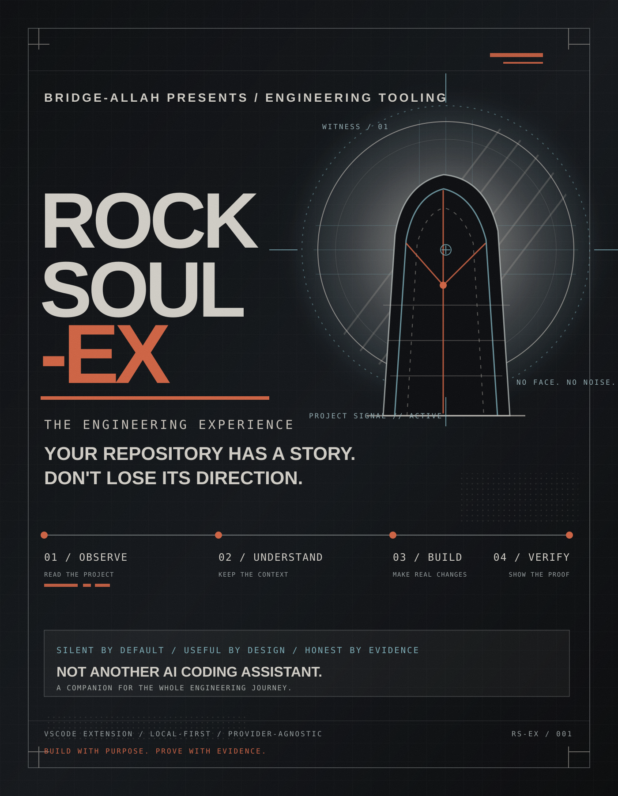

# ROCKSOUL-EX

**The Engineering Experience. Build with purpose. Prove with evidence.**

ROCKSOUL-EX is a proposed Visual Studio Code extension for developers who want an engineering companion that understands the direction of a repository—not just the next line of code.

**OBSERVE → UNDERSTAND → BUILD → VERIFY**

> Your repository has a story. Don't lose its direction.

## What it is

A local-first project companion that helps a developer inspect a workspace, preserve project DNA and decisions, turn goals into reviewable missions, work with a chosen AI provider, and verify outcomes with real evidence.

It is not another model, IDE, or chat wrapper. Its value is the continuity and engineering discipline around AI-assisted work.

## Product status

**Current stage: product blueprint / pre-implementation.**

This repository establishes the product narrative, behavior DNA, visual direction, architecture, security rules, and an implementation-ready MVP backlog. It does not yet contain a working VS Code extension. No feature should be described as implemented until code and verification evidence exist.

## Start here

| Document | Purpose |
|---|---|
| [Vision](docs/VISION.md) | Why ROCKSOUL-EX exists and what it should become |
| [Product definition](docs/PRODUCT.md) | Users, problems, promise, scope, and boundaries |
| [Behavior DNA](docs/DNA.md) | How ROCKSOUL observes, reasons, acts, and communicates |
| [Visual & UX direction](docs/UX-DIRECTION.md) | Art direction, interface principles, and design tokens |
| [Architecture](docs/ARCHITECTURE.md) | Proposed extension architecture and technical boundaries |
| [Core workflows](docs/WORKFLOWS.md) | First inspection, mission execution, handoff, and proof |
| [Security model](docs/SECURITY.md) | Workspace trust, privacy, execution, and prompt-injection boundaries |
| [Roadmap](docs/ROADMAP.md) | Product phases and measurable milestones |
| [Implementation backlog](docs/IMPLEMENTATION-BACKLOG.md) | Small tasks with acceptance criteria for a local coding agent |
| [Architecture decisions](docs/DECISIONS.md) | Decisions and constraints that prevent scope drift |
| [Poster direction](docs/POSTER.md) | Meaning and usage of the first visual concept |

## Product principles

1. Understand before changing. Start with a scoped, read-only inspection.
2. Keep context durable. Decisions should outlive a chat session or model change.
3. Make work reviewable. Every mission has scope, acceptance criteria, and a visible diff.
4. Prove completion. A task is not verified merely because an AI says it is done.
5. Keep humans in control. The developer owns intent, approval, and final judgment.
6. Stay local-first. No account, cloud backend, or hosted control plane is required for the initial product.

## Initial product loop

1. **Observe** — inspect the workspace and report what is known.
2. **Understand** — load project DNA, decisions, and active work.
3. **Build** — plan and apply a small, approved change.
4. **Verify** — run relevant checks and record evidence.

## Non-goals for the first release

- Building or training a foundation model.
- Replacing VS Code or a general-purpose coding assistant.
- Introducing a required cloud service or account.
- Running unrestricted shell commands or modifying files silently.
- Promising multi-agent autonomy before a reliable single-agent workflow exists.
- Becoming a full project-management, CI/CD, or deployment platform.

## Relationship to MoonWitness

ROCKSOUL-EX shares the Witness / Human Pen / Forge / Proof philosophy associated with the wider MoonWitness creative universe. The extension itself must remain a useful, independent developer tool. MoonWitness integration is optional and must never be a runtime dependency.

**ROCKSOUL-EX — Silent by default. Useful by design. Honest by evidence.**
